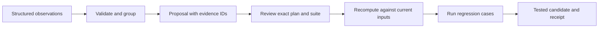

# A change needs a consumer

Feedback collection is only useful if someone can decide what should change and see whether that change helped. The private implementation combines deterministic collection with model-assisted review and a report read by the operator. This public example isolates the deterministic boundary and replaces the private inputs and judge with structured fixtures.

## Why these boundaries

**Feedback is evidence, not executable instruction.** Arbitrary text never becomes a command or a filename. This version allows one small presentation setting. Changing permissions, spending limits, or tool access requires a different workflow.

**Repetition needs context.** Exact retries and multiple messages in one session do not count as independent support. Distinct sessions are still only a heuristic, not distinct people or independent experiments. Opposing directions are held even when one side has more examples.

**Approvals have versions.** Approving a proposal does not approve a later configuration, edited observation set or weaker test suite. The plan contains the base configuration and selected-feedback digests; the review also binds the regression suite. The acceptance step recomputes the proposal before evaluating the candidate.

**A passing check has a narrow meaning.** The golden cases require the result and next action to survive compression. Reducing the budget to one bullet fails that check. This says nothing about tone, accuracy of an LLM's summary, or success on future inputs.

**Accepted is not deployed.** This module returns a candidate and receipt. It cannot update the private system. A real consumer needs authenticated approvals, an atomic update protocol, telemetry and rollback.

## Tests to inspect first

- One duplicated event cannot supply three votes.
- Opposing corrections are held.
- A changed base, observation, plan or suite invalidates the old approval.
- Even an approved proposal fails if it drops required facts.
- The original configuration is unchanged after acceptance or rejection.

This is an adaptation of a working practice, with new public demonstration code. The fixture dates, messages and approvals are invented; there are no private conversations or live results in the repository.
